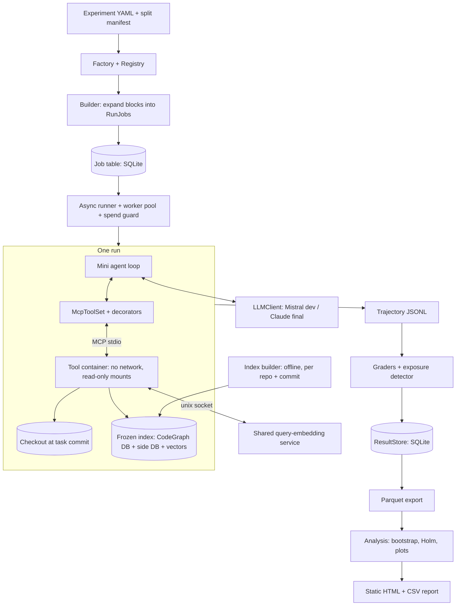
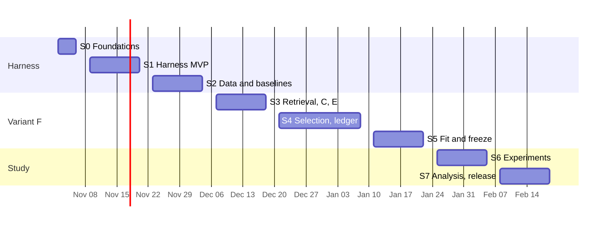

# Eval Harness — Design, Tech Stack and Delivery Plan

> An agent evaluation harness. Primary research question: **for a fixed agent, how do different code-index representations trade off localization accuracy against cost (tokens, tool calls, latency), and when does structure actually help?**
>
> Method contribution: **Variant F — budgeted multi-resolution context delivery (CodeGraph v2)**. Sub-question: *does it reduce tokens-to-localization vs CodeGraph and flat retrieval without losing accuracy?* Variants A–E and F0 (unmodified CodeGraph) are the baselines (§13).
>
> Multi-domain support is a design property of the core, not a v1 deliverable.

**Status:** ready for Sprint 0. **Delivery:** 8 sprints, 2026-11-02 to 2027-02-19 (§16). **Planning assumptions:** 2 full-time developers, about $4k LLM budget, one cloud VM for final runs (§17).

**Where to look:** research design §1a · analysis plan §9 · Variant F §13 · tech stack §14 · implementation plan §15 · sprints §16 · open items §17.

---

## 0. Decisions in this revision

| # | Decision | Why |
|---|---|---|
| D1 | No `temperature`; pin `output_config.effort` and API version | Non-default sampling values return 400 on Sonnet 5.5 and Haiku 5.5, and any value does on API version `2026-10-21`. Effort defaults differ by model, so unpinned effort would confound H3. |
| D2 | `seed` is a replicate label | No seed parameter is documented. Repeated calls are the only source of variance. |
| D3 | Final runs: primary model is Sonnet 5.5, small model is Haiku 5.5. Development uses Mistral (D19) | The old "frontier" label was wrong for Sonnet. Changing model is a config edit. |
| D4 | 600 tasks × 2 replicates for the core block; about 13,600 runs | Tasks add more power than replicates. The verified pool is larger than the old 150–300 plan. |
| D5 | H6 margin is set at Gate G3 from measured discordance (default 4 pp) | −2 pp is effectively unprovable: it needs about 1,100–4,400 tasks at the corrected α. |
| D6 | Confirmatory family cut to 3 tests; paired, repo-clustered bootstrap replaces McNemar | Seed-averaged differences are not binary, and tasks cluster by repo. |
| D7 | Tokens are split into billed and delivered; non-localized runs are censored, not dropped | Summing input per step counts context quadratically. Dropping failures hides survivorship. |
| D8 | "Localized" requires gold source in tool output, not a mention | Otherwise a one-line handle counts as finding the code, which biases the result towards F. |
| D9 | D and E use CodeGraph's graph, not a second extractor | Isolates representation from extractor quality and saves build work. |
| D10 | One runner image with read-only checkouts; no per-task Docker images | Localization runs no project code, so project dependencies are unnecessary. |
| D11 | Per-commit SQLite plus exact vector search; no Postgres or pgvector | C and F share a store, so latency isn't confounded. There is no ANN recall loss and no server to run. |
| D12 | Own thin core, not Inspect AI | The loop must expose exact token, cache and exposure data per step. Sandboxing here is only a read-only tool container. |
| D13 | Variant F maths corrected (§13): normalised `rel`, reverse edges, marginal ledger value, no L3 in the selector, no ½-approximation claim, 9 fitted values | The earlier formulas had scale, ledger and solver defects. |
| D14 | Additive arm (A+F0, A+F) runs on `test`; F0 keeps upstream's tools and text | Agents normally keep grep, and "unmodified" must mean unmodified. |
| D15 | Merkle re-index moved to Future Work | Experiments use immutable per-commit indexes. A per-file content-hash cache is enough. |
| D16 | `rel` is normalised per query to (0, 1] | Otherwise a broad query spreads `π_s` thinly and can fall below λ everywhere, returning only the floor handles. |
| D17 | `dev150` is repo-disjoint from `test_core` by default | Fitted parameters can't learn test repos. S0-3 checks the pool can support it; the fallback is `holdout_repos`. |
| D18 | Model claims are limited to the models in the final matrix (Sonnet 5.5 and Haiku 5.5 unless D3 changes) | Opus 5.5, Fable 5.1 and Mistral aren't in the final matrix, so results say nothing about them. Mistral dev runs are never reported as results. |
| D19 | Provider-neutral `LLMClient`; Mistral is the development backend | Mistral is cheap for building and debugging the MCP service, tool loop, logging and graders on `dev50`. Adapters convert at the boundary; the agent, graders and store see only neutral types. Adding a provider is one adapter class. |
| D20 | Delivered tokens and `T_loc` use one fixed reference tokenizer for every provider: `count_tokens` on `claude-sonnet-5-5` at the pinned API version. Provider-reported usage is used for billing only | Tokenizers differ across providers, so per-provider counts would make `T_loc` incomparable across models. Using the final primary model's counter keeps §13's `count_tokens` calibration and the no-`tiktoken` rule. Mistral dev runs need an Anthropic key to compute `T_loc`; without one it is logged as null. |
| D21 | Provider, model ID and SDK version are part of `config_hash`; one results set never mixes providers | Stops dev runs leaking into final results. |

---

## 1. Goals & Non-Goals

### Goals
- Run **agents × tasks × conditions × replicates** as a reproducible experiment matrix.
- Plug in new **domains, agents, tools, graders** without touching the core engine.
- Capture full **trajectories** (every step, tool call, token, latency) in one schema.
- Report **accuracy + cost + efficiency** with variance (Acc@k, mean, CI).
- First (and only v1) domain: **coding** — issue **localization**, with **index variant** as the key independent variable.

### Non-Goals (v1)
- Not a feature-rich coding agent.
- Not a UI/dashboard product (CLI + static HTML/CSV reports).
- Not distributed scheduling (local parallelism on one machine).
- Not a second domain.
- Not a new graph extractor. F reuses CodeGraph's graph; contributions are the **controlled comparison** and F's **retrieval + delivery method**.
- Not a claim about bug repair. Results apply to localization only (see the stretch pilot in §15).

---

## 1a. Research Design

### Independent variables
| Axis | Levels |
|---|---|
| **Index variant** | A `grep_read` · B `bm25` · C `embeddings` (BGE-M3, exact search) · D `ast_graph` (raw graph tools over CodeGraph's DB) · E `graph_summaries` (D + LLM module summaries) · F0 `codegraph_v1` (unmodified) · F0+dedup · **F `multires_v2`** |
| **Token budget** (F only) | 2k · 4k (default) · 8k · 16k per `explore_v2` call |
| **Model** | `claude-sonnet-5-5` (primary) · `claude-haiku-5-5` (small). Opus 5.5 and Fable 5.1 are not tested, and claims are limited to these two models |
| **Index freshness** | `fresh` · `stale_k20` (index frozen 20 first-parent commits before the task commit) |

**Controlled:** system prompt, agent loop, run budget, `read_file`, `grep` caps, `submit_locations`, effort, API version, SDK version.

**Differs by design:** retrieval tools (§7). Graph and handle tools cannot share one `search()`.
- B–E and F tool descriptions follow one template with similar length.
- F0 keeps upstream's tool list, descriptions and server instructions, injected into the system prompt as an MCP host would. Rewriting them would no longer be unmodified CodeGraph.
- Retrieval tool count and `prompt_overhead_tokens` are logged per run and reported.

### Run matrix
| Block | Purpose | Variants | Model | Freshness | Tasks | Replicates | Runs |
|---|---|---|---|---|---|---|---|
| Core | H1, H6, H7 baseline | A, D, F0, F0+dedup, F | primary | fresh | `test_core` 600 | 2 | 6,000 |
| Small model | H3 | same 5 | small | fresh | `test_sub` 150 | 2 | 1,500 |
| Staleness | H4 | B, D, F0, F | primary | stale_k20 | `stale100` | 2 | 800 |
| Staleness reference | H4 (B fresh) | B | primary | fresh | `stale100` | 2 | 200 |
| Breadth | H2, H5 | B, C, E | primary | fresh | `test_sub` | 2 | 900 |
| Ablations | H7 | 7 configs (§13.5) | primary | fresh | `test_sub` | 2 | 2,100 |
| Budget sweep | recall@budget | F at 2k, 8k, 16k | primary | fresh | `test_sub` | 2 | 900 |
| Additive | realistic setup | A+F0, A+F | primary | fresh | `test_sub` | 2 | 600 |
| Forced compaction | H8 | F, F − ledger | primary | fresh | `test_sub` | 2 | 600 |
| **Total** | | | | | | | **13,600** |

Also run: the memory-probe gate (one no-tool request per task per model, through the Message Batches API).

**Why the additive block runs on `test_sub`:** it is the realistic agent setup, and CodeGraph's FTS table has no body or string-literal column (`src/db/schema.sql:117`), so issues quoting an error message favour grep. `dev50` alone wouldn't show this on tasks F wasn't tuned against.

### Hypotheses
| ID | Hypothesis | Status |
|---|---|---|
| H1 | D beats A on function Acc@5 on `multi_hop` tasks, and the gap is larger than on `single_file` | **Confirmatory** if `multi_hop` ≥ 100 tasks in `test_core`, else exploratory |
| H2 | On `small` repos, A ≈ best variant | Exploratory; descriptive if < 30 tasks |
| H3 | The small model gains more from structure than the primary model | Exploratory |
| H4 | With a frozen index, structural variants (D, F0, F) degrade faster than lexical B. A reads live files and is the reference | Exploratory |
| H5 | E cuts tokens vs D at equal accuracy | Exploratory |
| H6 | F is **non-inferior** to F0 and to D on function Acc@5 **and** has lower restricted-mean tokens-to-localization | **Confirmatory** (2 tests: vs F0, vs D) |
| H7 | Each F component contributes measurable token savings. Expected order, untested: λ > ledger > selection > hub lift > hybrid seeds. The ledger must also beat F0+dedup | Exploratory |
| H8 | Under forced compaction, F's re-expansion rate stays low and its Acc@5 is non-inferior to F − ledger | Exploratory (same margin as H6) |
| H9 | F's advantage over F0 is largest on the `paraphrase` slice | Exploratory |

**Note on H4:** CodeGraph runs a catch-up sync when a project opens (`src/mcp/project-lifecycle.ts:176`), so in normal use it rarely stays stale at session start. `stale_k20` measures robustness of a frozen index, not F0's typical real-world state. Also report catch-up time from the `IndexBuildRecord`.

### Datasets
| Source | Verified size | Use |
|---|---|---|
| [`czlll/SWE-bench_Lite`](https://huggingface.co/datasets/czlll/SWE-bench_Lite) | 274 rows, `edit_functions` + `added_functions` | Pool |
| [`czlll/Loc-Bench_V1`](https://huggingface.co/datasets/czlll/Loc-Bench_V1) | 560 rows, same gold fields plus `category` | Pool |
| [SWE-bench-Live](https://huggingface.co/SWE-bench-Live) | 1,319 tasks / 93 repos in the [initial paper](https://arxiv.org/abs/2505.23419), updated monthly | Post-cutoff tasks; gold derived from patch |
| `datasets/coding/post_cutoff.jsonl` | about 30 hand-made, only if needed | Top up post-cutoff slice |

Neither `czlll` dataset page lists a license, and sampled rows look Python-only. Sprint 0 confirms overlap, languages, licensing and each model's training cutoff. **v1 is Python-only**, so results aren't confounded by per-language extractor quality.

**Splits** (frozen in a hashed manifest at Sprint 2):
- `dev150`: stratified; used for offline fitting only. **Repo-disjoint from `test_core` by default.**
- `dev50` ⊂ `dev150`: the only tasks used for live agent runs during development.
- `holdout_repos` (fallback): used only if S0-3 shows a repo-disjoint split leaves too few tasks. Then `dev150` may share repos with `test_core`, except for at least 2 repos with at least 30 tasks combined, which are reported as an `unseen_repo` slice.
- `test_core`: 600 tasks = 500 benchmark + 100 post-cutoff. Always task-disjoint from `dev150`.
- `test_sub` ⊂ `test_core`: 150 stratified tasks.
- `stale100` ⊂ `test_core`: up to 100 tasks with at least one gold file changed in the 20-commit window; if fewer exist, use all and record the count.

**Tags** (all mechanical):
- `multi_hop` = gold spans ≥ 2 files, else `single_file`.
- `repo_size` from node count: small, medium, large.
- `paraphrase` = issue text shares no identifier with gold symbols.
- `explicit_path` = issue text contains a gold path, for example in a stack trace.
- `created_after_cutoff`, `memorized`, `category`.

**Gold handling:**
- `added_functions` don't exist at the base commit. They count for file-level gold only; a task with no pre-existing gold function is excluded from function metrics.
- `hints_text` is never shown to the agent.
- `.git` is not mounted, so history can't leak the fix.

### Outcomes
- **Agent output:** the agent ends by calling `submit_locations` with up to 10 ranked locations (`path` or `path::symbol`).
  - At 85% of the context budget the harness adds one fixed "submit now" message, in every variant.
  - If the budget runs out without a submission, the list is empty.
- **Primary accuracy:** function Acc@5, hit-any. Hit-all is also reported because it matters on `multi_hop`.
- **Secondary accuracy:** file Acc@k, function Acc@k (k = 1, 5, 10), MRR.
- **Delivered tokens:** tool-result tokens plus model output tokens, including thinking. This excludes re-sent context, so it doesn't grow quadratically.
- **Exposure:** a tool output exposes a gold location if it contains that location's signature line, or at least 3 consecutive non-blank source lines from it (all lines if shorter). Matching ignores whitespace, so it works on any variant without tool cooperation. A path-only handle doesn't count.
- **Tokens-to-localization `T_loc` (primary cost):** delivered tokens up to the first exposure of a gold location that is also in the final top 5. Otherwise the run is censored at the run cap (90k), not dropped. Compared as restricted means; the localized-by-token curve and its median are also reported.
- **Secondary cost:** `T_body` (first body exposure), `T_mention` (first path mention, as a sensitivity check), delivered tokens to final answer, tool calls, wall time, and billed cost.
- **Fallback:** `read_file` calls and tokens after the first index call.
- **recall@token-budget** (F only): gold recall of a single `explore_v2` call at each budget.

---

## 2. Software Principles Applied

| Principle | How it shows up |
|---|---|
| **Single Responsibility** | Runner schedules, environment manages state, grader scores, logger records. |
| **Open/Closed** | New plugin = registered class + config. Engine code doesn't change. |
| **Liskov Substitution** | Any `AgentAdapter` is swappable; the runner never type-checks concrete classes. |
| **Interface Segregation** | Small protocols: `Environment`, `ToolSet`, `Grader`, `AgentAdapter`, `DatasetLoader`, `ResultStore`. |
| **Dependency Inversion** | Runner depends on protocols; concrete classes come from config + registry. |
| **Separation of Concerns** | **Core** (orchestration), **Plugins** (domain logic), **Infra** (storage, sandbox, LLM). |
| **Immutability** | `Task`, `RunConfig` and `RunResult` are frozen Pydantic models. Trajectories are append-only. |
| **Reproducibility** | Pinned commits, model IDs, API version, images and lockfile; a config hash on every result. |
| **Fail-safe** | One run crashing never stops the experiment. Each run has its own container, timeout and budget. |
| **YAGNI** | One domain in v1. An abstraction exists only with a current use. |
| **Observability** | Every step is a structured JSONL record; nothing is only printed. |

---

## 3. Design Patterns

| Pattern | Component | v1? |
|---|---|---|
| **Strategy** | `Grader`, `AgentAdapter` | Yes |
| **Adapter** | `McpToolSet`, `DatasetLoader` | Yes |
| **Registry** | `registry.py`: plugins register by name | Yes (one small dict) |
| **Factory** | `factory.py`: builds objects from config + registry | Yes |
| **Builder** | `builder.py`: expands blocks into `RunJob`s | Yes |
| **Decorator** | `ToolSet` wrappers: timing, budget, output cap, trajectory record | Yes |
| **Command** | `RunJob`: serializable, retryable, resumable | Yes |
| **Repository** | `ResultStore` over SQLite | Yes |
| **Proxy** | `CachedLLMClient`: `off`, `record`, `replay` | Yes, for tests only |
| **Context manager** | Run lifecycle `setup → run → teardown` | Yes (replaces Template Method) |
| EventBus, CompositeGrader, Null Object | | **Deferred**: a direct JSONL writer and a grader list cover v1 |

The cache key is prompt + params + replicate + run ID. `llm_cache` is `off` for experiments, so one replicate's response is never served to another.

---

## 4. Architecture



### Layers
- **Core:** `runner`, `builder`, `factory`, `registry`, `schemas`, `interfaces`. Domain-agnostic.
- **Plugins:** `domains/coding`, `agents`, `graders`, `indexes`.
- **Infra:** `sandbox`, `storage`, `llm`, `analysis`.

**Dependency rule:** Plugins → Core interfaces. Infra → Core interfaces. Core depends on nothing concrete.

### Runtime rules
- **All index tools go through MCP stdio,** so the harness has one tool path and latency is comparable. A–E share one Python server; F has its own; F0 is upstream's `codegraph serve --mcp --no-watch --no-telemetry`.
- **Tool containers** run with `--network none`, read-only checkout and index mounts, and a tmpfs for scratch.
- **Query embeddings** come from one shared service, so BGE-M3 isn't loaded per run. It serves C and F identically.
- **Frozen index:** `--no-watch` alone is not enough, because the catch-up `sync()` still runs. Upstream falls back to read-only serving when another live process holds the writer lock (`src/mcp/index.ts:146-149`). Sprint 0 validates that route; the fallback is a one-line patch recorded in the pinned build. **Acceptance test:** the DB's SHA-256 is unchanged after a run.

---

## 5. Core Interfaces

```python
# core/interfaces.py
from typing import Protocol, Any
from core.schemas import Task, Trajectory, GradeResult, ToolSpec, Budget, RunResult

class Environment(Protocol):
    async def __aenter__(self) -> "Environment": ...       # checkout + container up
    async def __aexit__(self, *exc) -> None: ...           # always cleans up

class ToolSet(Protocol):
    def specs(self) -> list[ToolSpec]: ...
    async def call(self, name: str, args: dict[str, Any]) -> str: ...

class AgentAdapter(Protocol):
    name: str
    async def run(self, task: Task, tools: ToolSet, budget: Budget) -> Trajectory: ...

class Grader(Protocol):
    name: str
    def score(self, task: Task, traj: Trajectory) -> list[GradeResult]: ...

class DatasetLoader(Protocol):
    def load(self, source: str) -> list[Task]: ...

class ResultStore(Protocol):
    def save(self, result: RunResult) -> None: ...
    def query(self, **filters) -> list[RunResult]: ...
```

```python
# plugins/graders/loc_acc_at_k.py
def _files(locations: list[str]) -> list[str]:
    return list(dict.fromkeys(loc.split("::", 1)[0] for loc in locations))

@register("grader", "loc_acc_at_k")
class LocAccAtK:
    name = "loc_acc_at_k"
    def score(self, task, traj):
        out = []
        files = _files(traj.final_locations)
        gold_files = set(task.gold.files)
        for k in (1, 5, 10):
            hit_any = bool(set(files[:k]) & gold_files)
            hit_all = gold_files <= set(files[:k])
            out.append(GradeResult(grader=f"file_acc_any@{k}", score=float(hit_any)))
            out.append(GradeResult(grader=f"file_acc_all@{k}", score=float(hit_all)))
        return out  # the function grader matches path + qualified-name suffix the same way
```

```python
# composition
tools = BudgetGuard(RecordingTool(OutputCap(McpToolSet(session)), traj), budget)
```

---

## 6. Data Schemas

```python
class Gold(BaseModel, frozen=True):
    files: tuple[str, ...]
    functions: tuple[str, ...]          # pre-existing at base commit only
    added_functions: tuple[str, ...]    # file-level credit only

class Task(BaseModel, frozen=True):
    id: str
    domain: str
    repo: str
    base_commit: str
    prompt: str
    gold: Gold
    source: str
    metadata: dict = {}   # multi_hop, repo_size, language, paraphrase, explicit_path,
                          # created_after_cutoff, memorized, category

class Step(BaseModel):
    idx: int
    role: Literal["assistant", "tool"]
    content: str
    tool_name: str | None = None
    tool_args: dict | None = None
    # assistant steps, copied from API usage
    input_tokens: int = 0
    cache_read_tokens: int = 0
    cache_write_tokens: int = 0
    output_tokens: int = 0
    # tool steps, counted after the run
    tool_output_tokens: int = 0
    exposures: tuple[str, ...] = ()     # gold IDs exposed; filled by the grader
    latency_s: float = 0.0

class Trajectory(BaseModel):
    run_id: str
    steps: list[Step]
    final_locations: list[str]          # ranked, max 10
    stop_reason: Literal["submitted", "budget", "timeout", "refusal", "error"]
    api_stop_reasons: dict[str, int]    # end_turn, tool_use, max_tokens, refusal ...

class RunResult(BaseModel, frozen=True):
    run_id: str
    experiment_id: str
    config_hash: str
    block: str
    agent: str
    task_id: str
    repo: str
    condition: str
    model: str
    effort: str
    index_fresh: bool
    budget_tokens: int | None
    replicate: int
    grades: list[GradeResult]
    # delivered
    delivered_tokens: int
    tokens_to_localization: int         # censored at cap when not localized
    localized: bool
    tokens_to_body: int
    tokens_to_mention: int
    prompt_overhead_tokens: int
    # billed
    input_tokens: int
    cache_read_tokens: int
    cache_write_tokens: int
    output_tokens: int
    cost_usd: float
    # behaviour
    n_steps: int
    wall_time_s: float
    index_calls: int
    read_file_calls: int
    read_file_calls_after_index: int
    read_file_tokens_after_index: int
    grep_calls: int
    retrieval_tools: int
    expand_calls: int
    re_expansions: int
    # health
    stop_reason: str
    infra_retries: int

class IndexBuildRecord(BaseModel, frozen=True):
    repo: str
    commit: str
    variant: str
    upstream_version: str
    build_time_s: float
    catchup_time_s: float | None
    build_tokens: int                   # > 0 only for graph_summaries
    embed_time_s: float
    embed_cache_hit_rate: float
    index_size_mb: float
    db_sha256: str
```

---

## 7. Experiment Config

```yaml
# experiments/code_index_variants.yaml
experiment: code_index_variants_v1
manifest: datasets/manifests/splits_v1.json     # hash stored with results

llm:
  api_version: "2026-10-21"
  sdk_lock: uv.lock
  cache_control: ephemeral                      # automatic prompt caching
  max_output_tokens: 16000
  fallbacks: off                                # never switch model mid-run
  models:
    primary: { id: claude-sonnet-5-5, effort: medium }
    small:   { id: claude-haiku-5-5,  effort: medium }
  # no temperature / top_p / top_k; tool_choice stays auto

conditions:
  grep_read:       { tools: [grep, read_file] }
  bm25:            { tools: [search_bm25, read_file] }
  embeddings:      { tools: [search_embed, read_file], params: { model: BAAI/bge-m3 } }
  ast_graph:       { tools: [search_graph, graph_neighbors, read_file] }
  graph_summaries: { tools: [search_graph, graph_neighbors, module_summary, read_file] }
  codegraph_v1:       { tools: upstream, extra: [read_file], params: { pin: f72c9d2 } }
  codegraph_v1_dedup: { tools: upstream, extra: [read_file], params: { pin: f72c9d2, env: { CODEGRAPH_EXPLORE_DEDUP: "1" } } }
  add_codegraph_v1:   { tools: upstream, extra: [grep, read_file], params: { pin: f72c9d2 } }
  multires_v2:     &f
    tools: [explore_v2, expand, read_file]
    params:
      budget_tokens: 4000
      alpha: 0.25
      rrf_k: 60
      fitted: fits/f_v1.json                    # tau, rho, beta, g_handle, g_l1, lambda
      dense_model: BAAI/bge-m3
      ledger: true
  add_multires_v2:
    <<: *f
    tools: [explore_v2, expand, grep, read_file]

tool_limits:
  grep:      { max_matches: 100, max_line_chars: 300 }
  read_file: { max_lines: 300 }

budget: { max_steps: 30, max_context_tokens: 90000, timeout_s: 600 }
# keeps prompts at or under Haiku 5.5's 100K price break
# the 85% "submit now" notice fires at 76,500

blocks:      # §1a; each block lists variants, model, freshness, split, replicates
  core:        { variants: [grep_read, ast_graph, codegraph_v1, codegraph_v1_dedup, multires_v2],
                 model: primary, freshness: fresh, split: test_core, replicates: [0, 1] }
  # small_model, staleness, stale_reference, breadth, ablations,
  # budget_sweep, additive, compaction follow the same shape

graders: [loc_acc_at_k, func_acc_at_k, mrr, exposure, process_metrics]

runner:
  workers: 8                # set from rate limits and VM size at G3
  infra_retries: 2          # infra failures only; agent failures are results
  llm_cache: off
  max_spend_usd: 4000       # hard stop
```

---

## 8. Folder Structure

```
Contour/
├── EVAL_HARNESS_DESIGN.md
├── ADDONS.md
├── pyproject.toml
├── uv.lock
├── justfile
├── .github/workflows/ci.yml
├── docker/
│   ├── runner.Dockerfile            # Python 3.12, ripgrep, Node 22, pinned CodeGraph
│   └── embed.Dockerfile             # BGE-M3 at a pinned revision
├── evalh/
│   ├── cli.py                       # evalh data|index|fit|run|grade|report
│   ├── core/                        # interfaces, schemas, registry, factory, builder, runner
│   ├── infra/
│   │   ├── sandbox/docker_env.py
│   │   ├── storage/sqlite_store.py
│   │   ├── llm/{client.py,mistral.py,anthropic.py,cache.py,tokens.py,pricing.py}
│   │   └── analysis/{bootstrap.py,tests.py,plots.py,report.py}
│   └── plugins/
│       ├── agents/mini_agent.py     # controlled loop + forced-compaction mode
│       ├── domains/coding/
│       │   ├── datasets.py          # loaders, dedupe
│       │   ├── gold.py              # gold from patch
│       │   ├── tags.py
│       │   ├── splits.py
│       │   ├── probe.py             # memory-probe batches
│       │   └── repos.py             # bare clones, worktrees, stale commits
│       ├── tools/
│       │   ├── mcp_toolset.py
│       │   └── decorators.py
│       ├── indexes/
│       │   ├── common/{chunks.py,fts.py,vectors.py,codegraph_db.py}
│       │   ├── server.py            # A–E MCP server
│       │   ├── grep_read.py
│       │   ├── bm25.py
│       │   ├── embeddings.py
│       │   ├── ast_graph.py
│       │   ├── graph_summaries.py
│       │   ├── codegraph_v1.py      # build + launch pinned upstream
│       │   └── multires_v2/
│       │       ├── ids.py           # stable IDs + body hashes
│       │       ├── levels.py        # handle, L1, L2 chunks, sizes
│       │       ├── centrality.py    # sparse graph, global PageRank
│       │       ├── seeds.py         # BM25 + dense + exact, RRF
│       │       ├── spread.py        # PPR with reverse edges, hub lift
│       │       ├── select.py        # selector
│       │       ├── ledger.py
│       │       ├── render.py
│       │       └── server.py        # explore_v2, expand, reset_ledger
│       └── graders/
│           ├── loc_acc_at_k.py
│           ├── func_acc_at_k.py
│           ├── mrr.py
│           ├── exposure.py
│           └── process_metrics.py
├── fits/                            # frozen fitted parameters
├── datasets/
│   ├── coding/post_cutoff.jsonl
│   └── manifests/
├── docs/{PREREGISTRATION.md,related_work.md,runbook.md}
├── experiments/*.yaml
├── runs/                            # gitignored
└── tests/
```

`cache/` (bare clones, worktrees, indexes, embeddings) lives outside the repo, set by `EVALH_CACHE`.

---

## 9. Metrics & Analysis Plan

- **Primary:** function Acc@5 (hit-any); `T_loc` restricted mean.
- **Secondary:** file and function Acc@k (hit-any and hit-all), MRR, `T_body`, delivered tokens, billed cost, tool calls, wall time, steps to first exposure.
- **Headline figure:** accuracy vs `T_loc` Pareto plot, plus localized-by-token curves.
- **Index cost:** build time, build tokens, embed cache hit rate and size, amortised per task.
- **Variant F:** recall@budget, early-stop rate, tokens used ÷ B, expansion rate, ledger hit rate, re-expansion rate, level mix.
- **Adoption:** index-call rate. Runs that never query the index are flagged and analysed separately.
- **Health:** refusal, `max_tokens`, timeout and infra-failure rates per variant. Differences are findings, not noise.
- **Slices:** `multi_hop`, `repo_size`, model, freshness, `paraphrase`, `explicit_path`, `memorized`, post-cutoff, `category`, and `unseen_repo` if the fallback split is used. Slices under 30 tasks are descriptive only.

### Inference
- **Unit:** task. Replicates are averaged within a task before comparison.
- **Interval method:** hierarchical paired bootstrap with 10,000 resamples: resample repos, then tasks within repos.
- **Non-inferiority (H6):** pass if the one-sided lower bound of Acc@5(F) − Acc@5(baseline) is above −m.
- **Token reduction (H6):** pass if the one-sided upper bound of restricted-mean `T_loc`(F) − `T_loc`(baseline) is below 0.
- **H6 requires both.** Each comparison (vs F0, vs D) passes only if both of its tests pass, so no within-comparison adjustment is needed.
- **Family:** Holm across H6-F0, H6-D and H1 (3 tests). All else is exploratory and labelled.
- **Sensitivity:** leave-one-repo-out, repo-weighted means, excluding `memorized`, excluding `explicit_path`, excluding refusals.

### Choosing the margin
Power with a true difference of 0, n = 600, α = 0.0167 (Holm's first step), by share of task pairs that disagree (d):

| Margin | d = 5% | d = 10% | d = 20% |
|---|---|---|---|
| 3 pp | 0.88 | 0.58 | 0.31 |
| 4 pp | 0.99 | 0.83 | 0.53 |
| 5 pp | 1.00 | 0.96 | 0.73 |

Tasks needed for 80% power at the same α:

| Margin | d = 5% | d = 10% | d = 20% |
|---|---|---|---|
| 2 pp | 1,102 | 2,204 | 4,408 |
| 3 pp | 490 | 980 | 1,959 |
| 4 pp | 276 | 551 | 1,102 |
| 5 pp | 177 | 353 | 706 |

These use a normal approximation and ignore repo clustering, so they are optimistic. **Rule at Gate G3:** simulate power by bootstrapping the dev50 pairs, then pre-register the smallest margin in {3, 4, 5} pp with at least 80% power. If none qualifies, report H6 as an estimate with its interval and make no non-inferiority claim.

---

## 10. Roadmap

| Sprint | Weeks | Dates | Outcome | Gate |
|---|---|---|---|---|
| S0 Foundations | 1 | Nov 2 – Nov 6 | Spikes de-risk API, CodeGraph and data | G0 |
| S1 Harness MVP | 2–3 | Nov 9 – Nov 20 | A and F0 run end to end | G0.5 |
| S2 Data + baselines | 4–5 | Nov 23 – Dec 4 | Frozen splits; stable dev50 baselines | **G1** |
| S3 F retrieval + C, E | 6–7 | Dec 7 – Dec 18 | F beats or matches F0 offline | **G2 go/no-go** |
| S4 F selection + ledger | 8–10 | Dec 21 – Jan 8 | F runs on dev50 | G2.5 |
| S5 Fit + freeze | 11–12 | Jan 11 – Jan 22 | Parameters and pre-registration frozen | **G3** |
| S6 Experiments | 13–14 | Jan 25 – Feb 5 | Matrix complete | G4 |
| S7 Analysis + release | 15–16 | Feb 8 – Feb 19 | Report, reproducible release | G5 |

The earlier 10-week plan had no room for a data pipeline, offline gates or a rehearsal, and its 1-week experiment phase didn't fit the matrix. Details are in §15 and §16.

**Future work:** L0 LLM summaries · learned edge weights from trajectories · embedding fine-tuning · question-type budgets · lazy reference resolution · SCIP-resolved edges · Merkle incremental re-index · external agent adapters · repair step + `tests_pass` · ledger identity on real MCP hosts · other languages · second domain.

---

## 11. Risks & Mitigations

| Risk | Mitigation |
|---|---|
| Contamination (model memorised repo) | Post-cutoff slice; memory-probe flags `memorized`; both reported |
| Prompt bias between conditions | Same system prompt; one template for B–E and F; upstream text kept for F0 and overhead reported |
| Cost blow-up | `max_spend_usd` hard stop; cost/run measured at G1; budget approved at G3; cut order in §16 |
| API rate limits | Measure limits at S0; worker count set from them; SDK backoff |
| API or model behaviour changes mid-study | Pin API and SDK versions; run the matrix in one window; 20-task canary daily during S6 |
| Over-engineering | Deferred patterns (§3); one domain |
| Flaky sandboxes | One image; health check; infra retries as Commands |
| Cache leaks across replicates | Replicate + run ID in key; `off` for experiments; isolation test |
| Agent ignores the index tool | Log `index_calls`; report adoption; treat as a finding |
| Too few tasks for the claim | 600 tasks; margin chosen from measured discordance (§9) |
| Few repos dominate results | Repo-clustered bootstrap; leave-one-repo-out; repo-weighted sensitivity |
| Peeking during S6 | The live monitor shows only ops metrics, not accuracy by variant; matrix fixed at G3 |
| Parameters overfit | Offline fit on repo-disjoint `dev150`; leave-one-repo-out; frozen before S6 |
| F0 silently self-heals in the stale arm | DB hash test on every stale run, for every indexed variant; a failure voids the run |
| API rejects run settings | No sampling params; explicit effort; fallbacks off; server-side context editing for H8; request-shape tests |
| Unfair comparison across variants | Same prompt, loop, budget and answer format; tool count and prompt overhead logged; additive arm; F0 also run with dedup on |
| Refusals differ by variant (`cyber` and similar classifiers) | Record `stop_reason: refusal`; fallbacks off; sensitivity excludes them |
| Ledger refers to code the agent has lost | Every reference has an `expand` handle; `reset_ledger`; re-expansion rate; `ledger: false` ablation |
| Real MCP hosts have no agent-context ID | v1 ledger scope = one server process = one run. Claim is limited to the mini agent; real hosts are Future Work |
| Localization win vanishes when editing is needed | Report `T_body` and fallback rate; claim scoped; stretch repair pilot |
| Name-matched edges are wrong in dynamic languages | Stored edge confidence in `w(e)`; ablations; SCIP edges are Future Work |
| Agent never calls `expand` | Tune tool description on dev50 only; log rate; treat as a finding |
| Upstream schema changes | Pinned commit + adapter tests |
| Laptop can't run the matrix | Dev on laptop with 2–4 workers; final runs on a VM (§14) |
| Dataset licensing unclear | Check at S0; do not redistribute task text until resolved |
| Variant F scope creep | Scope = levels + seeds + PPR/hub lift + selector/λ + ledger only |

---

## 12. Testing Strategy

No test in CI calls the live API. Live checks are `just smoke`, run by hand.

- **Unit:** every grader, decorator, gold parser, tag, matrix expansion and pricing function. Graders explicitly cover `path::symbol` answers against file gold, and hit-any vs hit-all on a multi-hop toy task.
- **Contract:** every registered plugin satisfies its Protocol; every tool server lists valid schemas.
- **Golden run:** a scripted fake agent on a toy repo yields an exact `RunResult`.
- **Replay:** `replay` mode gives an identical trajectory hash.
- **Replicate isolation:** two replicates in `record` mode never share a response.
- **Statistics:** on simulated data with known effects, bootstrap coverage is near nominal and Holm matches a hand-worked example.
- **Exposure detector:** handle-only output doesn't count; signature and body do; whitespace changes don't matter.
- **Frozen index:** for every indexed variant including F0, DB SHA-256 is unchanged after a stale run, and the stale commit's changes are absent from results.
- **API request shape:** no sampling params; `effort` always set; `tool_choice` is `auto`; fallbacks absent.
- **Variant F property tests (Hypothesis):**
  - Estimated tokens never exceed `budget_tokens`; live audit stays within 5%.
  - Raising λ never increases selected tokens.
  - Ledger hit → handle or skipped, never content.
  - A held L1 upgrading to L2 gets only marginal value.
  - Stable IDs survive a line-shifting edit.
  - Each PageRank vector sums to 1, including with dangling nodes.
  - Duplicating the graph as a disconnected copy leaves `h(v)` unchanged.
  - The top unit of every query has `rel` = 1, and all others are in (0, 1].
  - Every reference resolves through `expand`.
  - Changed content invalidates its ledger entry.
  - A container and its children never both emit body content.

---

## 13. Variant F — CodeGraph v2: Budgeted Multi-Resolution Context Delivery

Built as a **standalone MCP service reading CodeGraph's SQLite index** (MIT, pinned at `f72c9d2`, v1.6.2). No changes to CodeGraph until savings are proven in the harness.

**Positioning:** we don't compete on graph construction. The contribution is **retrieval + delivery**: one budgeted objective over all symbols, in place of CodeGraph's per-file allocation and tuned constants, with **9 fitted values** (4 τ, ρ, β, g_handle, g_L1, λ).

```
INDEX (offline, per commit)            RETRIEVE (per call)                     DELIVER (per run)
CodeGraph SQLite (nodes, edges, conf)  hybrid seeds (BM25 + dense + exact,     marginal value against the ledger
+ L1 skeletons / L2 cAST chunks          RRF)                                  held content → 1-line [seen] + handle
+ sizes, stable IDs, body hashes       → whole-graph PPR with reverse edges    plain text, no JSON wrapping
+ global PageRank                      → hub correction                        deterministic ordering
                                       → greedy selection with λ stop
```

### 13.0 Baseline gaps this targets (source analysis of CodeGraph `f72c9d2`)
| CodeGraph today | Where | Variant F |
|---|---|---|
| Budget in **characters**, tiers 13k/18k/24k, stated as a ceiling | `src/mcp/tools.ts:318,336,351,368` | Caller-set **token** ceiling plus a relevance stop (λ). Whether F0 usually fills its tier is **measured** |
| Budget split per file first, many constants | `tools.ts:802, 5055` | One global selection across files |
| Cross-call dedup **off by default**, line-range based, minimum 8 lines | `src/mcp/explore-dedup.ts:74-84` | Content-hash ledger, on by default, part of the objective |
| Lexical seeds only | `src/db/queries.ts:1868-1921`, `tools.ts:4598` | BM25 + dense + exact, RRF-fused |
| RWR over the gathered subgraph, undirected, restart 0.25 | `tools.ts:4328-4345` | PPR over the whole graph with typed, confidence-weighted edges and fitted reverse weight |
| BFS orders by kind (contains > calls > others), no fitted weights | `src/graph/traversal.ts:122-128` | `τ_kind × confidence` |
| No stored centrality | `src/db/schema.sql` | Hub correction |
| No stored bodies or token counts | `schema.sql` | Precomputed L1/L2 units with sizes |
| Node ID includes line number | `src/extraction/tree-sitter-helpers.ts:18` | Stable IDs + per-symbol body hash |

**Not yet verified in source:** dedup's "8-call memory", the 0.6–0.95 confidence range, and the Linux-kernel index time. Sprint 0 confirms or drops them; none affects the design. Edge confidence lives in `metadata.confidence` and defaults to 1 when absent.

### 13.1 Index
| Level | Content | Built from |
|---|---|---|
| handle | One line: `path:Lstart-end sym=name#hash (expand: h_xxxx)` | node row |
| L1 | Skeleton: signature, types, docstring | tree-sitter |
| L2 | Symbol body as cAST chunks (split large nodes, merge small siblings under a size cap) | tree-sitter |
| L3 | Exact line window, only through `expand(handle, start, end)`; not chosen by the selector | source |

Side database per (repo, commit), keyed to CodeGraph node rows:
- **Sizes:** characters per unit. Tokens are estimated at query time as `ceil(chars × r(model, language))`, where `r` is an upper-quantile (p90) ratio calibrated from a `count_tokens` sample. The same index serves every model, and no tokenizer is approximated with `tiktoken`.
- **Stable symbol ID:** `hash(file, kind, qualified_name, ordinal)`. CodeGraph's node IDs change on line shifts, so the mapping is rebuilt per commit.
- **Body hash:** per symbol and chunk; drives the ledger and a per-file build cache.
- **Global PageRank:** centrality per node.
- **FTS columns:** split identifiers, signature, docstring and **string literals** from the body. Without literals, an issue quoting an error message gives F nothing to match, since F has no grep. CodeGraph's own FTS table covers names, docstring and signature only.

Delivery reads text from the checkout using stored ranges. If a stored hash no longer matches in the stale condition, the unit is marked `[stale]`.

### 13.2 Retrieval
1. **Seeds:** Reciprocal Rank Fusion over the top 50 of each ranker:

   `s0(v) = Σ_{r ∈ {bm25, dense, exact}} 1 / (k + rank_r(v))`, k = 60

   Dense covers signatures + docstrings, with the same model and store as Variant C.

2. **Spread:** personalized PageRank from `s0` over the **whole graph**.

   Forward weight: `w(u→v) = τ_kind(e) × c(e)`. Reverse weight: `w(v→u) = ρ × τ_kind(e) × c(e)`.

   `P(u→v) = w(u,v) / Σ_x w(u,x)`, with `ρ ∈ [0, 1]`.

   `π_s = α · s0_norm + (1 − α) · Pᵀ π_s`, **α = 0.25 fixed**. A node with no outgoing weight returns its mass to `s0_norm`, so `π_s` always sums to 1.

   - ρ = 1 is undirected like CodeGraph, ρ = 0 is purely directed. A directed walk can't reach a helper's callers, so ρ is fitted, and ρ = 0 is an ablation. Fixing α alone doesn't remove this difference from F0.
   - τ uses 5 groups over the 13 edge kinds, with `calls` fixed at 1:

     | Group | Kinds | τ |
     |---|---|---|
     | Calls | `calls` | 1 (fixed) |
     | Hierarchy | `extends`, `implements`, `overrides` | fitted |
     | Type use | `instantiates`, `type_of`, `returns`, `decorates` | fitted |
     | Reference | `imports`, `exports`, `references`, `navigates` | fitted |
     | Containment | `contains` | fitted |

3. **Hub correction:**

   `h(v) = max(N · π_g(v), 1)`, `lift(v) = π_s(v) / h(v)^β`, β ∈ [0, 1]

   `rel(v) = lift(v) / max_u lift(u)`, so `rel` ∈ (0, 1] for each query

   `π_g` is global PageRank (same `P`, uniform restart) and N is the node count. `N · π_g` has mean 1 on any graph, so λ doesn't drift with repo size as a raw `π_s / π_g^β` would. The floor at 1 means only above-average hubs are demoted, and obscure leaves aren't inflated. Per-query normalisation stops a broad query, whose `π_s` is spread thinly, from falling below λ everywhere. β = 0 recovers plain PPR up to that scale.

### 13.3 Selection
Each symbol moves up the ladder `skip → handle → L1 → L2`.

**Value:**
- Handle: `v(u, handle) = rel(u) · g_h`. A pointer tells the agent this symbol matters to the *current* query, so it keeps its value even when the content was already sent.
- L1: `v(u, L1) = rel(u) · max(g_1 − g_held(u), 0)`.
- L2 chunk: `v(chunk) = rel(u) · (1 − max(g_1, g_held(u))) · share(chunk)`, zero if this chunk is already held. Requires the symbol at L1 or above.
- `g_L2 = 1` is fixed. `g_held(u)` is the gain of the highest content level the ledger holds at a matching hash, or 0.
- `share(chunk) = (1 + q) / Σ(1 + q)` where `q` is the chunk's BM25 score for the query, normalised within the symbol. A single-chunk symbol has share 1.

A ledger hit therefore has zero content value, and the best remaining option is a handle, rendered as `[seen]`, or nothing if `rel · g_h / c < λ`. A changed hash resets `g_held` to 0, so the content is re-sent.

**Cost:** `c` = estimated tokens of the increment. The first unit in a file also needs a one-time header. The header is charged against B but excluded from the ratio, which keeps the order fixed.

**Objective (heuristic):** `max Σ [v − λ·c]` subject to `Σ c ≤ B`.

**Solver:**
```python
selected = top_3_handles_by_rel()            # floor: a call never comes back empty
items = sorted(hull_increments(units), key=lambda i: (-i.dv / i.dc, i.stable_id))
for item in items:
    if item.dv / item.dc < lam:              # λ stop: B is a ceiling, not a target
        break
    if not item.follows_current_level(selected):
        continue
    if violates_containment(item, selected): # container body vs child content
        continue
    if tokens(selected) + item.dc + new_header_cost(item, selected) > B:
        continue
    selected.apply(item)
```

- `hull_increments` keeps each unit's upper convex hull, so its ratios decrease up the ladder.
- The order is fixed and λ only truncates it, so **raising λ can never increase tokens**.
- This is a greedy heuristic. Containment and shared headers break plain multiple-choice knapsack, so **no approximation guarantee is claimed**.
- L3 left the selector because a line window has lower gain and lower cost than L2, which breaks a monotone ladder. Chunks cover the partial-body case.

### 13.3a Fitting (offline, no LLM)
| Stage | Fits | Data | Objective |
|---|---|---|---|
| 1 Retrieval | 4 τ, ρ, β | `dev150`, issue text as query | Maximise gold-symbol recall@20; 300 seeded random configs, then coordinate refinement |
| 2 Selection | g_h, g_1, λ | `dev150` | Minimise mean selected tokens, subject to single-call gold exposure ≥ F0's − 2 pp |

- Each is cross-validated by leaving one repo out. Report per-fold values and sensitivity.
- Check that fitted λ gives similar early-stop rates across repo sizes.
- α sensitivity (0.1, 0.25, 0.5) runs on `dev150` only.
- Tool descriptions may be tuned on `dev50` agent runs, at most 3 rounds, all logged.

### 13.4 Delivery and ledger safeguards
- **Scope:** one server process per run, so the ledger is per run. MCP has no standard agent-context ID, so real-host scoping is Future Work.
- **Reference format:** `[seen] path:L10-42 sym=foo#a1b2  (expand: h_a1b2)`.
- **Safeguards:** every reference is expandable; a hash change invalidates the entry; `reset_ledger` for clients that compact; re-expansion rate is the health metric.
- **H8 compaction:** use server-side context editing (`clear_tool_uses_20250919`, beta `context-management-2025-06-27`), because editing earlier turns client-side can return a 400 under preserved thinking on newer accounts. Sprint 0 confirms this on Sonnet 5.5. Delivered tokens stay valid because they're counted per tool result, not from context deltas.
- **Output:** plain text with path header, line range and code, in deterministic order.

### 13.5 Ablations (`test_sub`, primary model, 2 replicates)
| Config | Levels | Selection | λ stop | Ledger | Hybrid seeds | Hub lift | Reverse edges |
|---|---|---|---|---|---|---|---|
| F-full (from core) | ✓ | ✓ | ✓ | ✓ | ✓ | ✓ | ✓ |
| F − λ (fill to B) | ✓ | ✓ | ✗ | ✓ | ✓ | ✓ | ✓ |
| F − hub (β = 0) | ✓ | ✓ | ✓ | ✓ | ✓ | ✗ | ✓ |
| F − ledger | ✓ | ✓ | ✓ | ✗ | ✓ | ✓ | ✓ |
| F − selection (L2, top-k) | ✓ | ✗ | ✗ | ✓ | ✓ | ✓ | ✓ |
| F − levels (L2 only) | ✗ | ✓ | ✓ | ✓ | ✓ | ✓ | ✓ |
| F − hybrid (BM25 only) | ✓ | ✓ | ✓ | ✓ | ✗ | ✓ | ✓ |
| F − reverse (ρ = 0) | ✓ | ✓ | ✓ | ✓ | ✓ | ✓ | ✗ |

- The ledger is compared against **both** F0 and F0+dedup. Beating only a disabled feature is not a result.
- Ablation parameters stay at F-full's fitted values.

### 13.6 Benchmarks for F
SWE-bench Lite, Loc-Bench and post-cutoff tasks only. RepoQA and CoIR are optional and out of the schedule.

### 13.7 F-specific risks
| Risk | Mitigation |
|---|---|
| CodeGraph may still win on tool calls or wall time | Report the Pareto front; no single "beats" claim |
| Gains come mostly from λ | Ablations isolate each component |
| Confidence values are fixed per resolver, not calibrated | Treat as a prior; sensitivity reported |
| Whole-graph PPR is too slow on large repos | Measure at S0 on the largest graph; sparse CSR cached per commit; target p95 < 500 ms; else cap iterations and report it |
| Token estimate drifts from actual | Upper-quantile ratio; live audit within 5% at G2.5 |
| Lexical blind spot on quoted error messages | F indexes string literals (§13.1); CodeGraph doesn't; the additive block measures what grep still adds |

### 13.8 Out of scope for v2
L0 LLM summaries · learned edge weights · embedding fine-tuning · question-type classifier · lazy reference resolution · SCIP-resolved edges · Merkle re-index.

---

## 14. Tech Stack

| Layer | Choice | Why | Rejected |
|---|---|---|---|
| Language | Python 3.12 | Already installed; best fit for numeric work and MCP | — |
| Packaging | `uv` + `uv.lock` | Already installed; exact reproducible environments | pip + requirements |
| LLM | Own `LLMClient` protocol with adapters: `mistralai` SDK (dev), `anthropic` SDK `AsyncAnthropic` (final); manual tool loop | Swappable providers; exact per-step usage and message control (D19) | Tool Runner, LangGraph, LiteLLM, Managed Agents |
| Models | Final: `claude-sonnet-5-5`, `claude-haiku-5-5`. Dev: `mistral-small-2603` (Devstral is not available on the current key), `mistralai` 3.7.0 | §0 D3, D19 | — |
| Tool protocol | `mcp` Python SDK, stdio | Upstream CodeGraph already speaks it; one path for all variants | In-process tools for some variants |
| Schemas | Pydantic v2 | Validation, frozen models, hashing | dataclasses |
| CLI / config | Typer, PyYAML | Small and typed | Hydra |
| Concurrency | `asyncio` + semaphores | Runs are mostly waiting on the API | Celery, Ray |
| Run isolation | Docker: one runner image, `--network none`, read-only mounts | D10 | SWE-bench per-task images |
| Graph source | CodeGraph `f72c9d2`, Node 22 **in the image** | Upstream requires Node ≥ 20 and < 25; local Node is 26 | Local install |
| Parsing | `tree-sitter` + `tree-sitter-python` | Same grammar family as CodeGraph; L1/L2 units | `ast` module (Python-only forever) |
| Lexical search | SQLite FTS5 `bm25()` | Same engine for B and F; nothing to run | Tantivy, Elasticsearch |
| Dense model | `BAAI/bge-m3` (MIT, 1024-dim) via `sentence-transformers`, pinned revision, dense vectors only | Same model for C and F | Hosted embeddings |
| Vector search | NumPy memmap per commit, exact cosine | No ANN recall loss; fast enough at this scale (to confirm at S0) | pgvector, FAISS |
| Embedding cache | Per-repo SQLite keyed by content hash | Most symbols repeat across commits | Re-embedding per commit |
| Graph maths | SciPy sparse CSR, power iteration | Simple and fast | NetworkX |
| Stores | SQLite (WAL) for jobs and results; JSONL for trajectories; `immutable=1` for read-only DBs | One file, no server | Postgres |
| Analysis | Polars, DuckDB, NumPy, SciPy; own tested bootstrap | Handles Parquet well | Pandas-heavy notebooks as source of truth |
| Plots / report | Matplotlib + Jinja2 static HTML, CSV | Non-goal: dashboard | Streamlit |
| Testing | `pytest`, `pytest-asyncio`, Hypothesis | Selector properties suit property tests | — |
| Quality | Ruff, mypy, pre-commit | Fast and standard | — |
| CI | GitHub Actions: lint, types, tests, no API key | Repo is already on GitHub | — |
| Task runner | `just` | Short, documented commands | Make on Windows |

### Dev backend rules (Mistral; confirm at S0)
- Pin the model ID and `mistralai` SDK version in `uv.lock` and config.
- `tool_choice` stays `auto`. Map `finish_reason` to the neutral stop reasons; keep the raw value for health metrics.
- Parse tool arguments defensively. Malformed JSON is logged as a tool-format error, not a retrieval failure.
- No prompt caching or effort parameter: `Capabilities` flags turn these off; cache fields are logged as 0.
- Check whether the free tier covers `dev50` before paying.

### API rules (from the current Claude API guide; confirm at S0)
- Send no `temperature`, `top_p` or `top_k`.
- Set `output_config={"effort": "medium"}` on every call.
- Leave thinking at its default. Thinking tokens count in output.
- `tool_choice` stays `auto`, because forced tool use returns 400 on Sonnet 5.5. Give `submit_locations` a strict schema.
- Use `count_tokens` for token counts, never `tiktoken`. Delivered tokens and `T_loc` still use the D20 reference tokenizer.
- Check `stop_reason` for `refusal` and `max_tokens` before reading content.
- Read `cache_read_input_tokens` and `cache_creation_input_tokens` from usage.
- Do not configure server-side fallbacks.
- Use the Message Batches API for the memory probe and E's summaries, which are single calls. Agent runs are multi-turn and use the standard API.

### Compute
| Stage | Machine | Notes |
|---|---|---|
| Development | Current laptop: Ryzen 7 8845HS (8 cores), 13.8 GB RAM, about 214 GB free, no CUDA GPU | 2–4 workers on `dev50`. Start Docker Desktop (the daemon was not running when checked) and keep checkouts inside the WSL2 filesystem, not `/mnt/c` |
| Bulk embedding | Cloud GPU, hours | CPU on the laptop is likely too slow. Measure on `dev150` first |
| Index builds + final runs | Linux VM, about 16 vCPU, 64 GB RAM, 1 TB NVMe, for about 4 weeks across S5–S6 | Exact size set from S2 measurements |

### Budget (estimates; replaced by measurements at G1)
| Item | Estimate | Basis |
|---|---|---|
| Matrix, primary | about $2,350 | 12,100 runs × $0.19 |
| Matrix, small | about $15 | 1,500 runs × $0.01 |
| Dev, rehearsal, probes, summaries | about $700 | About 20–30% on top |
| Contingency | about $900 | About 30% |
| **LLM total** | **about $4,000** | The `max_spend_usd` default |
| VM + GPU | about $300–800 | Rough, not quoted; get a quote before G3 |

**Per-run assumption:** 8 turns, 35k final context, 8k output, about 55% average cached re-read per later turn, with cache writes at 1.25× and reads at 0.1× input price. **Prices used:** Sonnet 5.5 $2/$10, Haiku 5.5 $0.10/$0.50, per MTok. Using Opus 5.5 as primary would roughly double the primary cost.

**Runtime:** 13,600 runs × 2 min (assumed) = about 2.4 days at 8 workers, or 4.7 at 4. Index builds are extra.

---

## 15. Implementation Plan

### Build order
```
S0 spikes → harness → data + gold → A, F0 → stats → G1 baselines
                                                   ↓
              B, D, C, E (parallel) ←──── shared index infrastructure
                                                   ↓
              F retrieval → G2 offline → F selection + ledger → fit → G3 freeze → run → report
```

**Rules that keep the study valid:**
1. No Variant F agent runs before G1.
2. Live agent runs during development use `dev50` only. **`test_core` isn't touched until G3.**
3. After G3, no change to F, tools, prompts, graders or analysis code except a documented bug fix. A fix that affects results voids the affected runs, and all are rerun.
4. Every number in the report traces to a config hash.

### Work packages
| WP | Scope | Key modules | Done when |
|---|---|---|---|
| WP1 Core | Schemas, registry, builder, runner, job store, resume | `core/`, `infra/storage` | Golden-run and resume tests pass |
| WP2 LLM + agent | Client, usage, pricing, spend guard, mini agent, compaction | `infra/llm`, `agents/` | Request-shape tests pass; live smoke works |
| WP3 Environment | Clones, worktrees, image, containers, MCP toolset | `sandbox`, `tools`, `repos.py` | No network; read-only mounts verified |
| WP4 Data | Loaders, gold, tags, splits, probe | `domains/coding` | Gold agrees with `edit_functions`; manifest frozen |
| WP5 Baselines | A, B, D, F0, F0+dedup | `indexes/` | Toy-repo contract tests pass; frozen-index test passes |
| WP6 Breadth | C, E, embedding service and cache | `indexes/` | Sanity check on `dev50` |
| WP7 Graders + analysis | Exposure, accuracy, bootstrap, Holm, plots, report | `graders/`, `analysis/` | Simulated-data tests pass |
| WP8 Variant F | Index, retrieval, selector, ledger, server, fit | `multires_v2/`, `fits/` | §12 property tests pass; G2 and G2.5 pass |
| WP9 Experiments | Pre-registration, rehearsal, matrix, canary, runbook | `docs/`, `experiments/` | G3 and G4 pass |
| WP10 Release | Report, reproducibility, packaging | | G5 passes |

---

## 16. Sprint Timeline

**Cadence:** Monday start, Friday-of-week-2 review, gate decision at review. **Owners:** **A** = harness + experiments, **B** = indexes + Variant F. Estimates are person-days (pd), not commitments. Capacity is 20 pd per 2-week sprint.

### S0 — Foundations (Nov 2 – Nov 6, 10 pd)
| ID | Task | Own | pd | Acceptance |
|---|---|---|---|---|
| S0-1 | Scaffold: uv, Ruff, mypy, pytest, CI, just | A | 1 | CI green on `dev1` |
| S0-2 | API spike: request shape, effort, repeat variance, Models API, `count_tokens` limits, rate limits, context editing | A | 2 | Script and notes in `docs/`; all rules in §14 confirmed or amended |
| S0-3 | Dataset census: overlap, languages, repos, `multi_hop` and `paraphrase` counts, post-cutoff supply, stale eligibility, licenses, model cutoffs | A | 2 | Census table; pool supports a repo-disjoint `dev150` + `test_core` (750 tasks, 100 of them post-cutoff), or G0 switches to the `holdout_repos` fallback |
| S0-4 | CodeGraph spike: pinned build in Node 22 container; index a large Python repo; MCP over stdio; frozen-index route | B | 2 | DB hash unchanged after a stale session |
| S0-5 | Schema spike: read DB from Python; edge metadata; PPR latency on the largest graph; verify §13.0 open items | B | 2 | Latency recorded; items confirmed or dropped |
| S0-6 | Related work notes, time-boxed: RepoGraph, LocAgent, cAST, Agentless | B | 1 | `docs/related_work.md` |

**G0:** API works as specified; stale F0 can be frozen; pool is sufficient; PPR latency acceptable. **If frozen F0 fails:** apply the patch route or drop F0 from the stale arm.

### S1 — Harness MVP (Nov 9 – Nov 20, 20 pd)
| ID | Task | Own | pd | Acceptance |
|---|---|---|---|---|
| S1-1 | Schemas, registry, factory, config hash | A | 2 | Contract tests |
| S1-2 | Builder + job table + async runner + resume + retries | A | 3 | Kill and resume loses no job |
| S1-3 | LLM client: usage, caching, refusal, pricing, spend guard, record/replay | A | 3 | Request-shape and replay tests |
| S1-4 | Mini agent, `submit_locations`, budget notice | A | 2 | Golden-run test |
| S1-5 | Repo cache, worktrees, runner image, container lifecycle | B | 3 | No network; read-only verified |
| S1-6 | `McpToolSet` + decorators; A–E server skeleton; `grep_read` | B | 2 | Contract tests |
| S1-7 | F0 adapter: build, launch, dedup flag, upstream text injection | B | 2 | One real task via MCP |
| S1-8 | Graders: accuracy, MRR, exposure, `T_loc`, process metrics | B | 3 | Unit tests on hand-built trajectories |

**G0.5:** one real task runs end to end for A, F0 and F0+dedup, and the result is correct when checked by hand.

### S2 — Data + baselines (Nov 23 – Dec 4, 20 pd)
| ID | Task | Own | pd | Acceptance |
|---|---|---|---|---|
| S2-1 | Gold from patch | B | 3 | At least 95% agreement with `edit_functions`; differences reviewed |
| S2-2 | Tags, splits, manifest | A | 2 | Hash committed; stratification table |
| S2-3 | Memory-probe batches | A | 1 | `memorized` flags stored |
| S2-4 | Index build for `dev150`; `IndexBuildRecord` | B | 2 | Time and disk per commit known |
| S2-5 | B `bm25` + FTS module; D `ast_graph` | B | 5 | Toy-repo tests; `dev50` sanity |
| S2-6 | Statistics: bootstrap, non-inferiority, Holm, power simulation | A | 3 | Simulated-data tests |
| S2-7 | Baseline: A, F0, F0+dedup, D on `dev50`, 2 batches of 2 replicates | A | 3 | Results stored |
| S2-8 | Report v0; per-tool token counting | A | 1 | HTML report |

**G1 (go/no-go for Variant F):**
- Two batches' seed-averaged Acc@5 differ by ≤ 5 pp per variant.
- Infra failure rate < 2%; adoption and refusal rates known.
- Effort stays fixed, and at most 5% of runs hit the context cap. Otherwise raise the cap and re-check Haiku pricing.
- Measured cost/run, time/run and discordance; §14 budget updated.

### S3 — F retrieval, C, E (Dec 7 – Dec 18, 20 pd)
| ID | Task | Own | pd | Acceptance |
|---|---|---|---|---|
| S3-1 | Side DB: stable IDs, hashes, L1, L2 chunks, sizes, token ratios | B | 4 | ID-stability tests |
| S3-2 | Seeds: FTS columns with literals, dense, exact, RRF | B | 3 | Unit tests |
| S3-3 | Graph, `π_g`, PPR, ρ, dangling handling, hub lift | B | 3 | PageRank and duplicate-graph tests |
| S3-4 | Offline bench: F vs F0 single call, recall by tokens | A | 3 | `evalh offline` report on `dev150` |
| S3-5 | Embedding service, content-addressed cache, GPU bulk job, C | A | 4 | Sanity on `dev50`; cache hit rate logged |
| S3-6 | E summaries via Batch API; `IndexBuildRecord` tokens | A | 3 | Sanity on `dev50` |

**G2 (go/no-go):** at equal token spend on `dev150`, F's retrieval recall is at least F0's − 2 pp overall **and** higher on `paraphrase`. **If not:** take one week to diagnose. If still failing, stop F, skip S4–S5 F work, and publish the baseline study (A–E, F0).

### S4 — F selection + ledger (Dec 21 – Jan 8, 20 pd, 3 calendar weeks to allow for holidays)
| ID | Task | Own | pd | Acceptance |
|---|---|---|---|---|
| S4-1 | Selector: hull, λ, containment, headers, floor | B | 4 | All property tests |
| S4-2 | Ledger, `expand`, `reset_ledger`, render | B | 3 | Ledger tests |
| S4-3 | F MCP server + per-file build cache | B | 2 | One real task |
| S4-4 | Ablation flags and config entries | B | 1 | Each ablation runs on a toy repo |
| S4-5 | Compaction mode; additive mode | A | 3 | H8 path works on the live API |
| S4-6 | F on `dev50`; tool-description rounds (max 3) | A | 4 | Logged rounds |
| S4-7 | Run monitor (ops only), runbook, failed-run rerun | A | 3 | Runbook reviewed |

**G2.5:** F completes `dev50` with no budget violation, live token audit within 5%, and an adoption rate reported.

### S5 — Fit + freeze (Jan 11 – Jan 22, 20 pd)
| ID | Task | Own | pd | Acceptance |
|---|---|---|---|---|
| S5-1 | Stage 1 fit | B | 3 | `fits/` candidate + fold report |
| S5-2 | Stage 2 fit | B | 2 | Constraint met |
| S5-3 | Sensitivity + leave-one-repo-out | B | 2 | λ stable across repo sizes |
| S5-4 | Provision VM; build all test indexes; hash them | B | 3 | Build manifest complete |
| S5-5 | All arms on `dev50` with frozen parameters | A | 3 | Discordance measured |
| S5-6 | Power simulation; margin; `docs/PREREGISTRATION.md` | A | 3 | Reviewed by both |
| S5-7 | Dress rehearsal: about 5% of the matrix's arms on `dev150` tasks, on the VM | A | 2 | Throughput, disk and cost measured; no `test_core` task used |
| S5-8 | Final budget and worker count | A | 2 | Spend cap approved |

**G3 (freeze):** git tag `prereg-v1` covers code, config, manifest, fits, images and index hashes. H6 margin, family, exclusions and rerun rules are written down. Budget approved. **`test_core` opens only after this.**

### S6 — Experiments (Jan 25 – Feb 5, 20 pd)
| ID | Task | Own | pd | Acceptance |
|---|---|---|---|---|
| S6-1 | Canary, then Core block | A | 4 | Core complete first; it answers the main claim |
| S6-2 | Small, Stale, Stale reference | A | 3 | DB hash test passes on every stale run |
| S6-3 | Ablations, Budget sweep | B | 3 | Complete |
| S6-4 | Breadth, Additive, Compaction | B | 3 | Complete |
| S6-5 | Failure triage + reruns per pre-registered rules | A, B | 3 | Each failure classified |
| S6-6 | Post-run token counting, grading | B | 2 | All results graded |
| S6-7 | Slack for API incidents or reruns | A, B | 2 | |

**G4:** at least 99% of planned runs have valid results; infra failures are rerun, agent failures are not; spend within cap. Ops metrics only until complete.

### S7 — Analysis + release (Feb 8 – Feb 19, 20 pd)
| ID | Task | Own | pd | Acceptance |
|---|---|---|---|---|
| S7-1 | Confirmatory tests exactly as pre-registered | A | 2 | Script in repo; output unchanged on rerun |
| S7-2 | Exploratory analysis and slices | A | 3 | Clearly labelled |
| S7-3 | Pareto plot, recall curves, ablation table | B | 3 | Figures generated from Parquet |
| S7-4 | Report | A, B | 6 | All numbers trace to a config hash |
| S7-5 | Reproducibility: clean checkout rebuilds report; 20 runs replayed | B | 2 | Pass |
| S7-6 | Release: docs, license check, tag | A, B | 2 | No undistributable data |
| S7-7 | **Stretch:** repair pilot (30 tasks; A, F0, F) or Claude Code smoke (10 tasks) | A, B | 2 | Labelled pilot only |

**G5:** report states conclusions at the pre-registered margin, including null results. Rebuild passes.

### Timeline


### If it slips
**Cut in this order:**
1. S7 stretch.
2. E (`graph_summaries`).
3. C (`embeddings`), keeping dense seeds in F.
4. Budget sweep at 8k and 16k.
5. Small-model block.
6. Ablations down to λ, ledger, hybrid.
7. `test_core` down to 400 tasks, which requires a wider margin.

**Never cut:** A, D, F0, F0+dedup and F in the core block, the additive arm, pre-registration and `test_core` isolation.

**Slip triggers:** a gate missed by more than 3 working days means applying the next cut, not compressing S6 or S5.

**One developer:** run A's and B's tracks in sequence, about 28 weeks; or cut items 2–6 for about 20 weeks.

---

## 17. Readiness

### Before Sprint 0 begins
| Item | Owner | Default if no decision |
|---|---|---|
| Confirm team: 2 full-time developers | Project lead | Plan as written; one developer → see §16 |
| Confirm LLM budget about $4k, plus VM | Project lead | Hold at this cap; if lower, use the cut list |
| API key with enough rate limit | Project lead | S0-2 measures it |
| Start date | Project lead | 2026-11-02; shift all dates together |
| Start Docker Desktop | Dev | Required for S0-4 |

### Resolved in Sprint 0
Dataset overlap and license · model training cutoffs · frozen-index route · context editing on Sonnet 5.5 · `count_tokens` limits · PPR latency · §13.0 open items.

### Definition of done for the study
- H1 and H6 each have a pre-registered decision, including "not shown".
- Every confirmatory number reproduces from `prereg-v1` and stored results.
- Index build cost and all health rates are reported per variant.
- The report limits claims to localization, Python and the mini agent.

### Facts behind this plan
- **Checked in source (`f72c9d2`):** tiers, dedup default and minimum, node IDs, edge confidence storage and default, undirected RWR, catch-up sync, read-only fallback, CLI flags, 13 edge kinds, Node engine range.
- **Checked on the web, 2026-11-01:** dataset row counts and fields; BGE-M3 license, dimension. SWE-bench-Live's current size was not confirmed, only the paper's figure.
- **From the Claude API guide bundled with Claude Code (not yet tested live):** all rules in §14 and prices. S0-2 checks them.
- **Assumed:** 2 min/run, per-run tokens, discordance rates, VM cost, team size, budget. G1 and G3 replace the measurable ones.
